

  

<h1 align="center">HomeLLM</h1>

<b>Your own ChatGPT, at home.</b> A private AI assistant that runs on your PC and reaches your phone anywhere. No account. No cloud. No one reading along.

  
  
  
  

  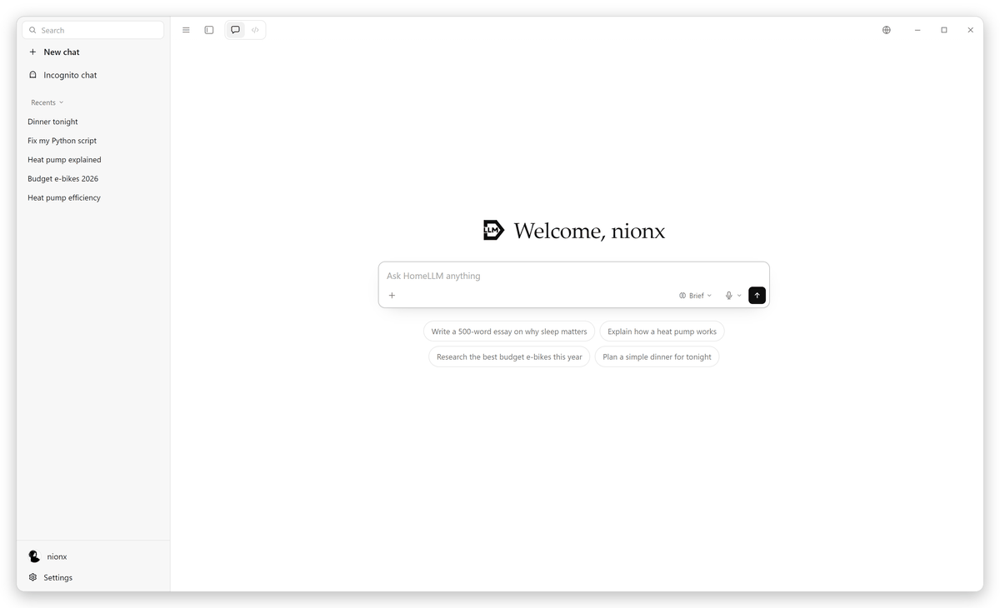

## What is HomeLLM?

HomeLLM gives you what the big AI apps give you, on hardware you own. Install it on a PC with a
graphics card, open it on any device in the house or anywhere else, and talk to a model that never
sends a word outside your home.

It is one download. On a capable PC it runs the model itself. On a phone, a laptop or in a browser it
is the same app, connected to the HomeLLM you already have.

  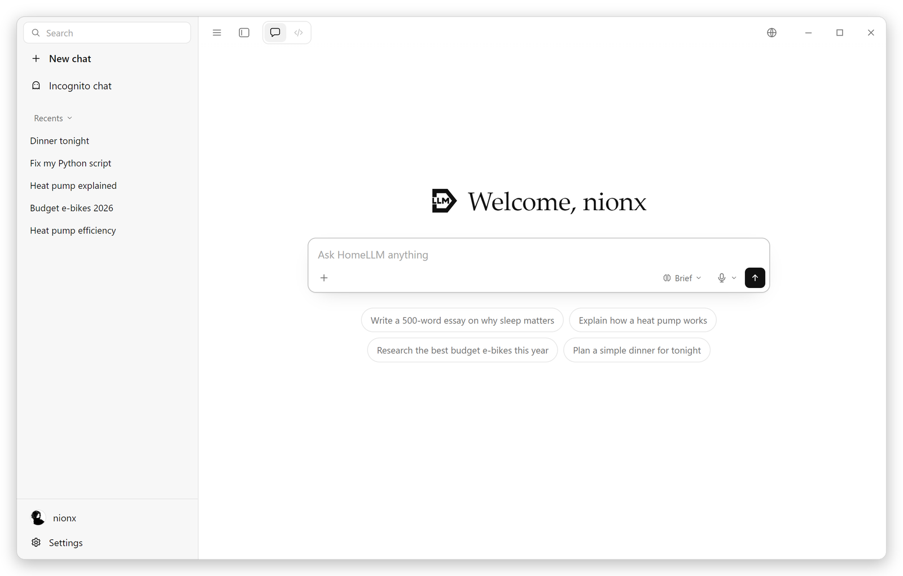

## What you get

**A real assistant.** Chat with memory across conversations, thinking modes you can tune and rename,
profiles with passcodes for everyone in the house, and an incognito mode that keeps nothing.

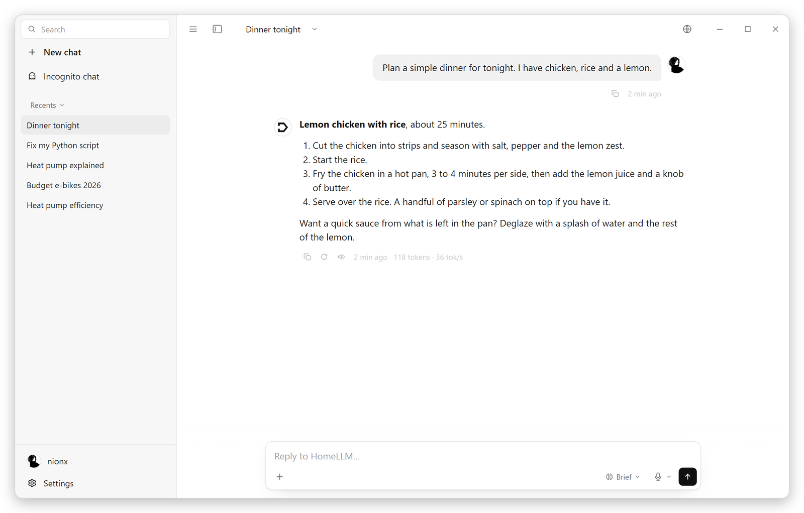

**Writes code like the pros.** A side panel that writes files live, previews HTML and Markdown, edits in
place instead of rewriting, and lets you download the result.

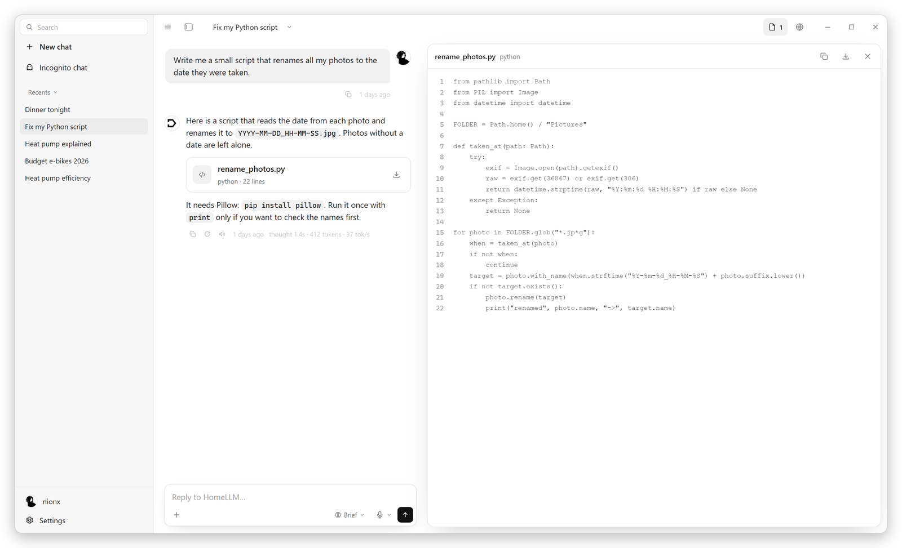

**Edits you can watch.** When the assistant changes a file, the lines it replaces turn red and the new
ones appear in green as it types, and a GitHub-style diff lands under the reply. The code in the panel
is yours to edit too, with Ctrl+S, and every file has a live link that updates while you work.

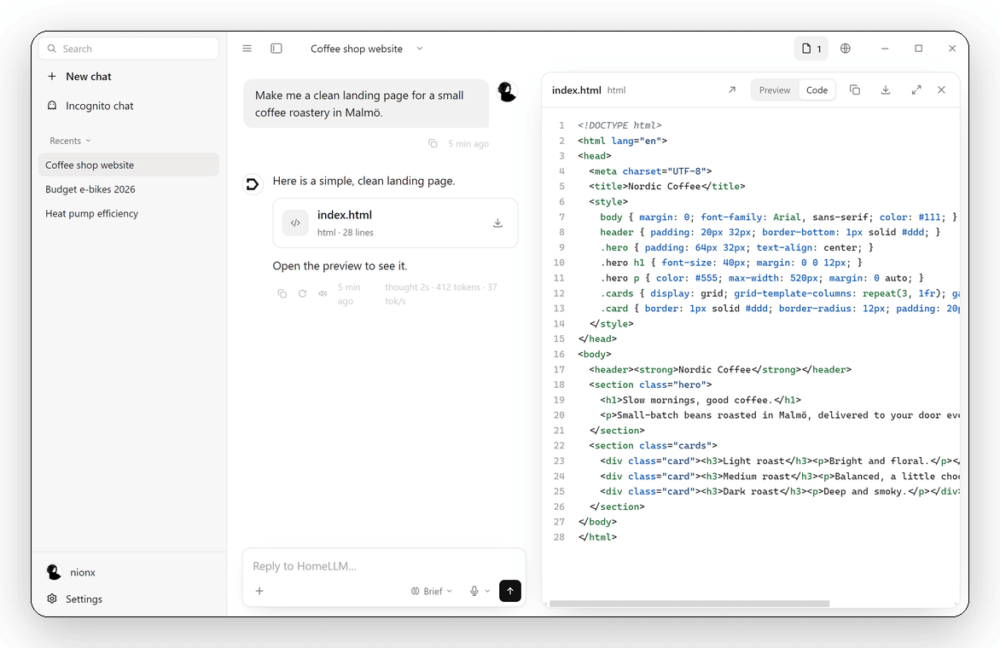

**Your editor, your colours.** Six colour themes for the code panel, from GitHub Light to One Dark and Dracula.

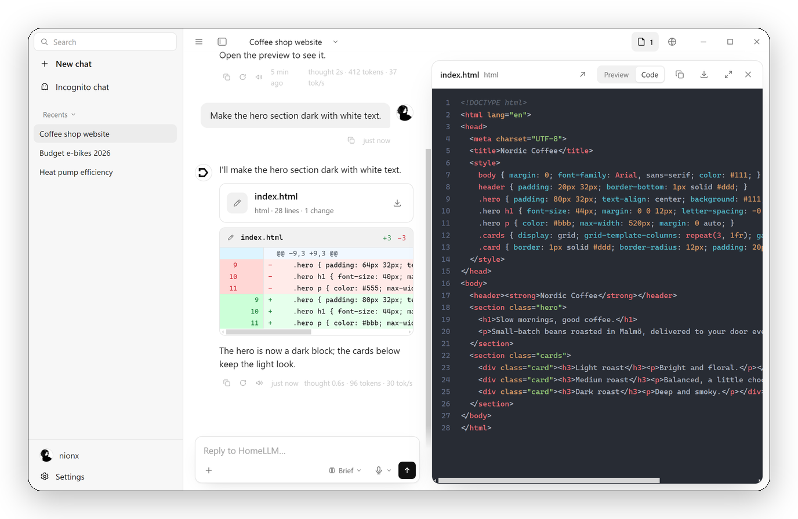

**Uses a browser, with your consent.** A built-in browser the assistant can drive: open, read, click,
type. You choose how much it may do on its own, and every action shows as a card in the reply.

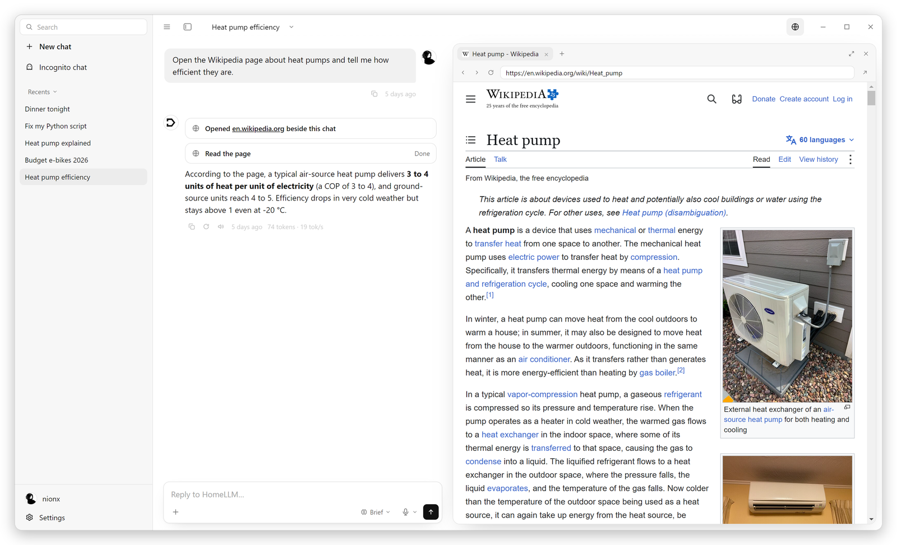

**Point at anything.** Pick an element on a page, see what it is, and add it to your message. The
assistant gets the selector, the role and the text, and finds the same element when it reads the page.

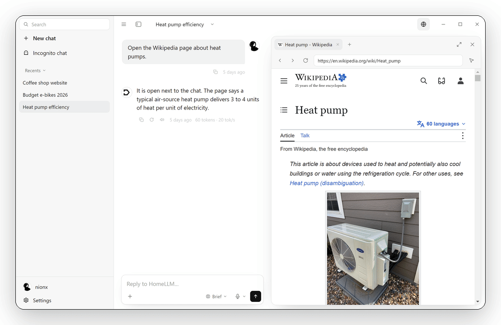

**Panels your way.** Dock the browser and the code panel left, right, top or bottom, fill the window,
resize with a grip, or run both side by side on a wide screen. Any of them opens in its own HomeLLM window.

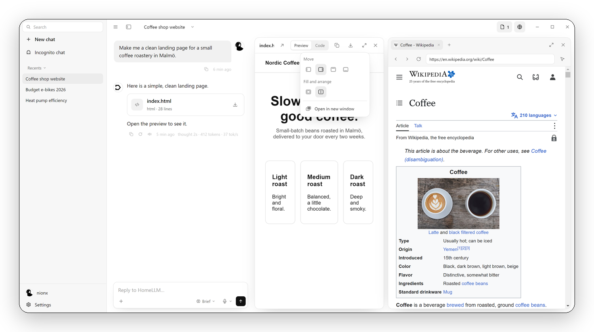

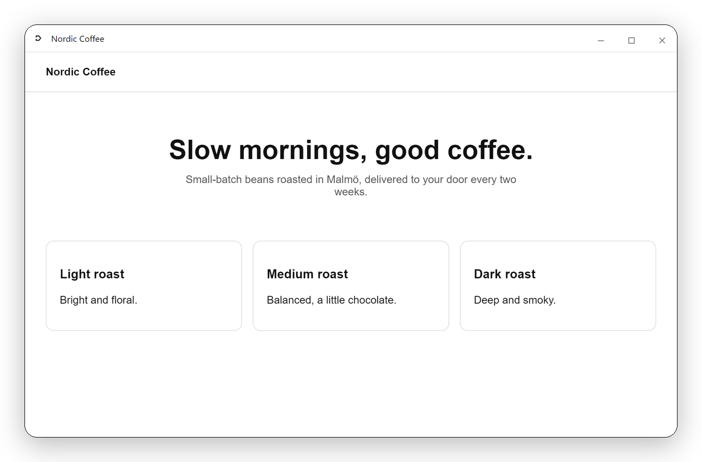

**Reads the web for you.** A self-hosted search engine behind Web search and Deep research. Sources
show up as chips right in the text; hover one to see what it is, click to open it.

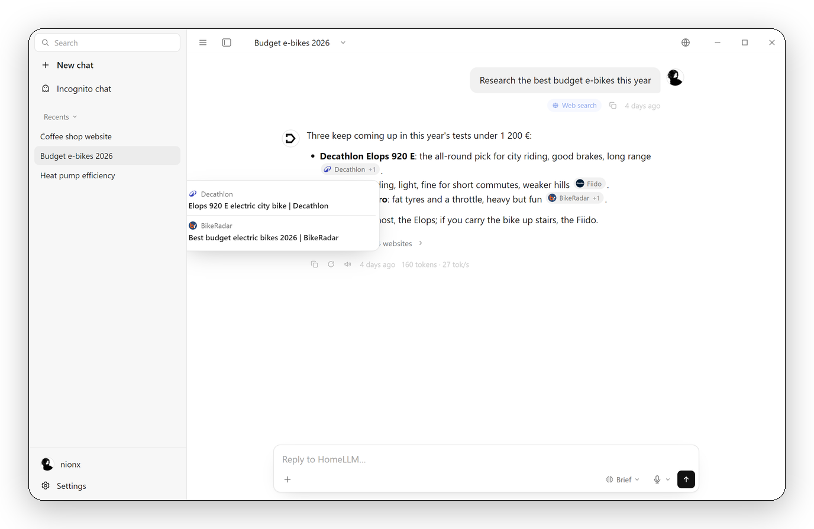

**Sees and hears.** Drop in photos and PDFs. Dictate with offline speech recognition, pick your
microphone, hold to talk.

**Finds the right model for you.** A setup wizard scans your graphics card and memory and recommends a
model that fits, with lighter and heavier options. Search any GGUF on Hugging Face, import your own, or
plug in a cloud AI key if you want one. Give models nicknames.

**Respects your PC.** The model sleeps when you are not using it and wakes on the next message. Gaming
mode hands the whole graphics card back to your games.

**Goes where you go.** Start a question on your phone, read the answer on your PC. Replies keep
streaming through a refresh or a lost connection.

  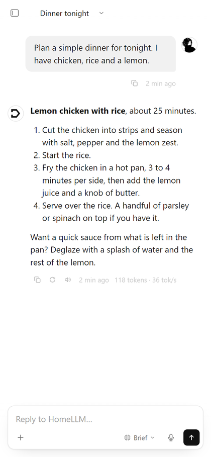
  &nbsp;&nbsp;&nbsp;
  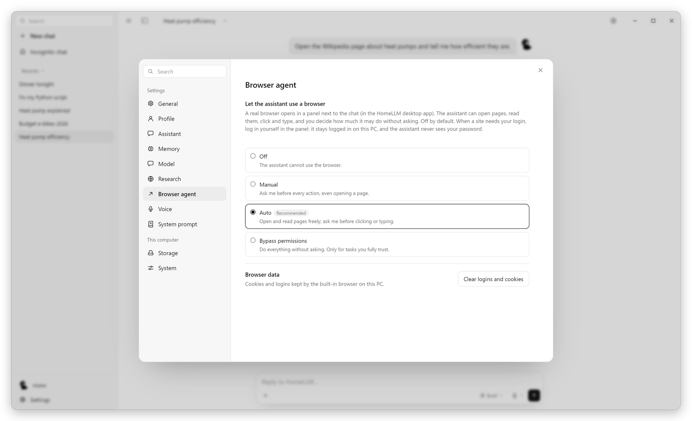

## Two ways to run it

| | **HomeLLM** | **HomeLLM Server** |
|---|---|---|
| For | A PC with a graphics card, and every device that connects to it | A machine in a cupboard, a home server, a hosted box |
| Looks like | A desktop app with its own window, a phone app, a web page | No window. The engine and the API, managed from any HomeLLM app |
| Reach | This PC, the home network, or anywhere through the HomeLLM Network | Same, built for being reached from outside |
| Setup | Click the installer, run the wizard | One command, then pair your first device |

Devices pair once with a code. Nothing else can reach your HomeLLM, wherever it is.

## Status

**Code arrives soon.** HomeLLM is being built in the open and is already in daily use by its author.
The first public release includes the Windows desktop app, the server stack and the phone web app.

- [x] Chat, vision, dictation, web research, code panel
- [x] Setup wizard with hardware scan and model recommendations
- [x] Profiles, memory, incognito, power management
- [x] Browser agent with consent modes and an element picker
- [x] Live edits with diffs, editable code panel, colour themes
- [x] Dockable panels, side by side, pop-out windows
- [x] Cross-device replies, in-app updates
- [ ] HomeLLM Server package and installer
- [ ] HomeLLM Network: connect from anywhere with zero configuration
- [ ] Public release

Star the repository to be told when it lands, and watch [homellm.cloud](https://homellm.cloud).

## Why

The useful AI assistants all run on someone else's computer. Everything you type goes there, is stored
there and is read by whatever that company decides. A good open model on a normal gaming PC is now
enough for most of what people use ChatGPT for. HomeLLM is the missing piece: the polished app around
it, so running your own is not a weekend project.

## License

[MIT](LICENSE). Use it, change it, share it.
